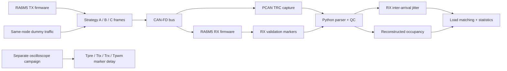
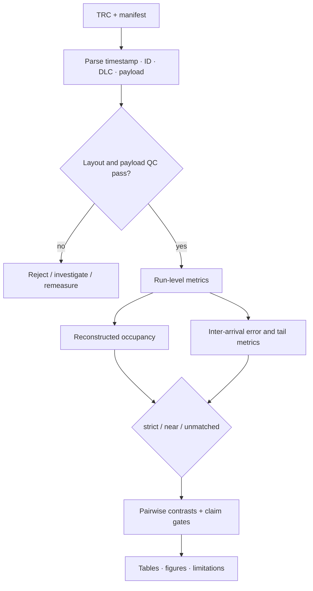

# CAN-FD Signal Packing and Receive-Timing Evaluation

[한국어](README.md) | [English](README.en.md)

> [!IMPORTANT]
> **This repository records the preliminary campaign from July 2026**, in which the same TX node also sent the dummy load frames. The study was then repeated with a three-node setup and an independent background TX node. That work found a confound: matching the load had also changed the background-traffic generation gap. The conclusion was therefore revised so that large jitter differences between strategies are not attributed to packing, and the result was **submitted** as a full paper to the KSAE 2026 Annual Autumn Conference (Sep 2026). Read the numbers in Section 6 as **early observations**, not the final conclusion. The three-node re-experiment, the confound checks, and the evidence for the final conclusion are in [`final_campaign/`](final_campaign); the headline numbers of both campaigns can be recomputed from the published summary tables with `python tools/verify_headline_numbers.py`.

> A study evaluating how three packings of the same 64-byte mixed-period workload affect **RX inter-arrival jitter** and model-based reconstructed occupancy, using RA6M5 TX/RX nodes and PCAN traces.

| Item | Details |
|---|---|
| Question | How signal packing changes receive-frame interval variation |
| Setup | RA6M5 TX/RX, CAN-FD, PCAN traces, separate oscilloscope campaign |
| Primary metric | 0x100 RX inter-arrival jitter |
| Dataset | 3 strategies × 4 loads × 10 runs = 120 TRC files |
| Status | Preliminary-campaign record (before the final paper). Co-researchers’ consent to publish confirmed by the owner (2026-10-21); no software license selected |

## Quick Navigation

- [`firmware/`](firmware): candidate A/B/C TX/RX experiment source
- [`analysis/`](analysis): parser, QC, statistics, figures, and summary tables
- [`docs/experiment_design.md`](docs/experiment_design.md): experiment design
- [`docs/limitations.md`](docs/limitations.md): measurement and interpretation limits
- [`sample_data/`](sample_data): synthetic format sample, not real measurement data
- [`LICENSE_REVIEW.md`](LICENSE_REVIEW.md): ownership and publication status

## 1. Research Objective

The study compares how distributing mixed-period signals across multiple CAN-FD frames or combining them changes receive timing and transmission occupancy. It does not seek to establish a universally superior strategy. The objective is to **record observed differences under matched payload and test conditions with an explicit interpretation boundary**.

## 2. Packing Strategies

| Strategy | 5 ms group | 50 ms group | Concept |
|---|---|---|---|
| A | 8 B + 8 B + 16 B | 8 B + 8 B + 16 B | Distributed small frames |
| B | One 32 B frame | One 32 B frame | One frame per period group |
| C | Entire 64 B in one 5 ms frame | Normal signals repeated with it | Maximum packing |

Repeated payloads for the same ID are byte-identical to control payload-dependent bit-stuffing variation where possible.

## 3. Experiment Architecture



### Analysis flow



## 4. My Contribution

- Organized the TRC parsing, run-level QC, statistics, figure generation, and review pipeline
- Validated actual timestamps, CAN IDs, DLCs, payloads, and bitrates rather than relying on filenames
- Identified mismatches between the test plan and captured traces, normalized conditions, and repeated measurements
- Applied strict/near/unmatched load-matching gates and explicit result claim gates
- Separated measured quantities, reconstructed metrics, and the independent oscilloscope campaign
- Wrote the final report and audited the release candidate for personal data, absolute paths, and prohibited files

The Git history begins at the release-candidate packaging stage and does not prove original authorship of all firmware and analysis source. Joint research source is not presented as my sole work.

## 5. Problems and Solutions

| Problem | Solution | Effect |
|---|---|---|
| Filenames could disagree with actual conditions | Checked IDs, DLCs, payloads, timestamps, and bitrates directly | Prevented misclassified runs from entering statistics |
| Load conditions were not always identical | Applied reconstructed-occupancy matching gates | Separated directly comparable conditions |
| Full ordering failed at a high-load condition | Preserved the failed claim gate | Avoided favorable-result selection |
| TRC and scope were different campaigns | Documented sources and measurement definitions separately | Avoided treating different delays as one-way latency |
| Dummy load came from the same TX node | Recorded the contention limitation explicitly | Prevented overgeneralization to external multi-node contention |

## 6. Validation and Results

- All layout/payload/QC gates passed for 3 strategies × 4 conditions × 10 runs (120 TRC files)
- A60 RX inter-arrival jitter: **59.764 μs**
- C60 RX inter-arrival jitter: **22.098 μs**
- A60–C60 difference: **37.667 μs**
- Strict-matched reconstructed-occupancy difference: **-0.091382 percentage point**
- 80% A/B/C full-ordering claim gate: **FAIL** — no complete ordering claim is made

These are preliminary-campaign observations; in the later three-node re-test, large differences between strategies were not confirmed as a packing effect. Reproduction of these values requires the private source TRCs and manifest. The candidate public sample validates format only and cannot reproduce the final statistics.

## 7. Reproduction

[`sample_data/synthetic_example.trc`](sample_data/synthetic_example.trc) and [`expected_output.csv`](sample_data/expected_output.csv) document the parser format and expected ID/DLC/frame counts. The sample alone cannot run the final analysis.

Run the private source analysis with:

```bash
python analysis/scripts/analyze_fixed2_64b_n10.py \
  --input <private-trc-directory> \
  --output <output-directory> \
  --manifest <private-manifest.csv> \
  --bootstrap 20000 \
  --seed 20260721
```

## 8. Repository Structure

```text
.
├─ firmware/             # Candidate RA6M5 A/B/C TX/RX source
├─ analysis/
│  ├─ config/            # Portable analysis configuration
│  ├─ scripts/           # Parser, QC, statistics
│  ├─ figures/           # Derived plots
│  └─ summary_tables/    # Run/condition-level results
├─ docs/                 # Architecture, design, limitations
├─ sample_data/          # Synthetic sample only
├─ README.md
├─ README.en.md
└─ LICENSE_REVIEW.md
```

## 9. Measurement Limitations

1. The primary metric is **RX inter-arrival jitter**, not transmit-to-receive one-way latency.
2. **Reconstructed occupancy** is calculated from frame length and bitrate assumptions, not actual PCAN-measured bus load.
3. Scope `D_wr2rx` and `D_rx2pwm` are marker-to-marker delays from a separate campaign, not physical PWM edges or pure bus latency.
4. Same-node dummy traffic does not isolate pure external-node contention.
5. The study does not establish motor stability, PID oscillation, or real actuator response.
6. Worst-case response time (WCRT) was not analyzed, and measured PCAN bus load was not stored in the run tables; every load value is reconstructed occupancy.

## 10. Attribution and Publication Status

This repository contains joint team/laboratory research. The repository owner confirmed the co-researchers’ consent to publish on 2026-10-21. No software license has been selected, so it is **All rights reserved**: it may be viewed, but no reuse permission is granted. Real TRCs, scope source data, FSP-generated artifacts, internal laboratory documents, and personal records are not approved for public distribution.
