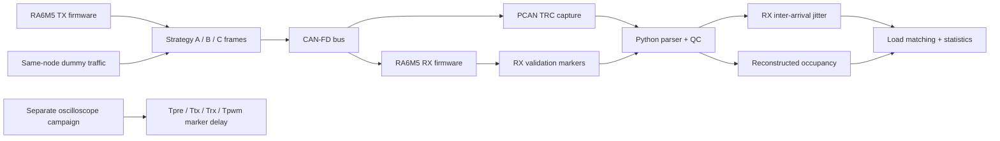
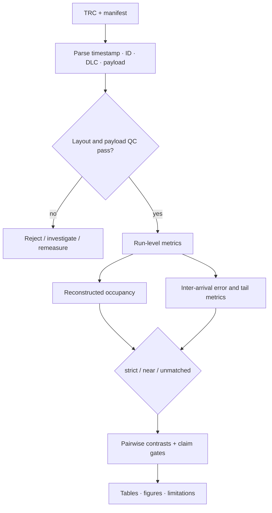

# CAN-FD 신호 패킹과 수신 타이밍 평가

[한국어](README.md) | [English](README.en.md)

> 동일한 64 B mixed-period workload를 A/B/C 방식으로 패킹했을 때 **RX inter-arrival jitter**와 model 기반 reconstructed occupancy가 어떻게 달라지는지 RA6M5 TX/RX와 PCAN trace로 평가한 연구 저장소입니다.

| 항목 | 내용 |
|---|---|
| 핵심 질문 | 신호 패킹 방식이 수신 frame 간격의 변동에 미치는 영향 |
| 실험 장치 | RA6M5 TX/RX, CAN-FD, PCAN trace, 별도 oscilloscope campaign |
| 주 지표 | 0x100 RX inter-arrival jitter |
| 데이터 | 3 strategies × 4 loads × 10 runs = 120 TRC |
| 상태 | 비공개 연구 저장소, 외부 공개·license 승인 대기 |

## 빠른 탐색

- [`firmware/`](firmware): A/B/C TX/RX 실험 source 후보
- [`analysis/`](analysis): parser, QC, 통계, figure와 summary table
- [`docs/experiment_design.md`](docs/experiment_design.md): 실험 설계
- [`docs/limitations.md`](docs/limitations.md): 측정·해석 한계
- [`sample_data/`](sample_data): 실제 측정이 아닌 synthetic format sample
- [`LICENSE_REVIEW.md`](LICENSE_REVIEW.md): 저작권·공개 상태

## 1. 연구 목적

주기가 다른 signal을 여러 CAN-FD frame으로 나누거나 한 frame에 통합했을 때 수신 간격의 jitter와 전송 점유 형태가 어떻게 달라지는지 비교합니다. 목표는 특정 전략의 보편적 우위를 주장하는 것이 아니라, **동일 payload와 통제된 조건에서 관측된 차이와 그 해석 범위를 재현 가능하게 기록하는 것**입니다.

## 2. 패킹 전략

| 전략 | 5 ms signal group | 50 ms signal group | 개념 |
|---|---|---|---|
| A | 8 B + 8 B + 16 B | 8 B + 8 B + 16 B | 여러 소형 frame으로 분산 |
| B | 32 B frame 1개 | 32 B frame 1개 | 주기 group별 통합 |
| C | 전체 64 B를 5 ms frame 1개에 통합 | normal signal도 함께 반복 | 최대 패킹 |

동일 ID의 반복 payload는 byte-identical하게 고정해 payload에 따른 bit-stuffing pattern 차이를 가능한 범위에서 통제했습니다.

## 3. 실험 구조



### 분석 흐름



## 4. My Contribution

- TRC parsing, run-level QC, 통계·figure 생성 pipeline 구성과 결과 검토
- 파일명이 아니라 실제 timestamp, CAN ID, DLC, payload와 bitrate를 이용한 조건 확인
- 실험 계획과 trace 조건 불일치 발견, 조건 통일과 재측정
- strict/near/unmatched load-matching gate 및 결과 claim gate 적용
- 측정값, reconstructed metric과 별도 scope campaign을 구분한 결과 해석
- 최종 연구 보고서 작성 및 공개 후보 package의 개인정보·절대경로·금지 파일 검사

현재 Git history는 공개 후보 package를 만든 시점부터 시작하므로 firmware와 분석 source 전체의 최초 작성자를 증명하지 않습니다. 공동 연구 source를 단독 저작물로 주장하지 않습니다.

## 5. 주요 문제와 해결

| 문제 | 해결 | 효과 |
|---|---|---|
| 파일명과 실제 run 조건이 다를 가능성 | ID/DLC/payload/timestamp/bitrate 직접 검사 | 잘못 분류된 run의 통계 유입 방지 |
| 부하 조건이 완전히 일치하지 않음 | reconstructed occupancy 기반 matching gate | 직접 비교 가능한 조건 분리 |
| 높은 부하에서 전체 순서 가정이 실패 | failed claim gate를 그대로 보존 | 유리한 결과만 선택하는 오류 방지 |
| TRC와 scope가 다른 campaign | source·측정 정의를 별도 기술 | 서로 다른 지연을 one-way latency로 혼동하지 않음 |
| dummy traffic도 동일 TX node에서 생성 | 명시적인 contention 한계 기록 | 외부 다중 node 경합으로 과도하게 일반화하지 않음 |

## 6. 검증과 결과

- 3 strategies × 4 conditions × 10 runs, 총 120 TRC의 layout/payload/QC gate 통과
- A60 RX inter-arrival jitter: **59.764 μs**
- C60 RX inter-arrival jitter: **22.098 μs**
- A60–C60 차이: **37.667 μs**
- strict-matched reconstructed occupancy 차이: **-0.091382 percentage point**
- 80% 조건의 A/B/C full-ordering claim gate: **FAIL** — 완전한 순서를 주장하지 않음

위 수치는 비공개 원본 TRC와 manifest가 있어야 재현됩니다. 공개 후보 sample은 형식 확인용 synthetic data일 뿐 최종 통계를 재현하지 않습니다.

## 7. 재현 방법

[`sample_data/synthetic_example.trc`](sample_data/synthetic_example.trc)와 [`expected_output.csv`](sample_data/expected_output.csv)는 parser 입력 형식과 예상 ID/DLC·frame count를 검토하기 위한 자료입니다. 이 sample만으로 최종 분석은 실행되지 않습니다.

비공개 원본 분석:

```bash
python analysis/scripts/analyze_fixed2_64b_n10.py \
  --input <private-trc-directory> \
  --output <output-directory> \
  --manifest <private-manifest.csv> \
  --bootstrap 20000 \
  --seed 20260721
```

## 8. 저장소 구조

```text
.
├─ firmware/             # RA6M5 A/B/C TX/RX source candidate
├─ analysis/
│  ├─ config/            # portable analysis configuration
│  ├─ scripts/           # parser, QC, statistics
│  ├─ figures/           # derived plots
│  └─ summary_tables/    # run/condition-level results
├─ docs/                 # architecture, design, limitations
├─ sample_data/          # synthetic sample only
├─ README.md
├─ README.en.md
└─ LICENSE_REVIEW.md
```

## 9. 측정 한계

1. 주 지표는 **RX inter-arrival jitter**이며 송신부터 수신까지의 one-way latency가 아닙니다.
2. **Reconstructed occupancy**는 frame length와 bitrate 가정으로 계산한 값이며 PCAN actual measured load가 아닙니다.
3. Scope의 `D_wr2rx`, `D_rx2pwm`은 별도 campaign의 marker-to-marker delay이며 실제 PWM edge나 pure bus latency가 아닙니다.
4. Same-node dummy traffic은 외부 node 간 contention만을 분리하지 못합니다.
5. Motor stability, PID 진동과 실제 actuator response를 입증하지 않습니다.

## 10. Attribution 및 공개 상태

이 저장소는 팀·연구실 공동 연구 자료이며 현재 **LICENSE PENDING** 상태입니다. 외부 공개 전 작성자·관리자 승인, firmware 소유권, 파생 수치·figure의 공개 범위와 제3자 license를 확인해야 합니다. 실제 TRC, scope 원본, FSP 생성물, 연구실 내부 문서와 개인정보 자료는 외부 공개 대상이 아닙니다.
